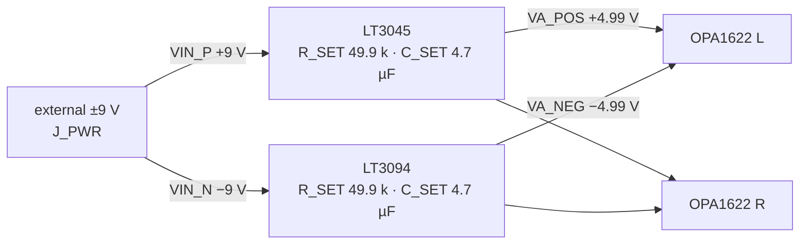
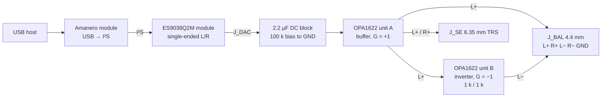

# lossless-dac

A balanced headphone amplifier board with ultralow-noise ±5 V rails (LT3045/LT3094) and one OPA1622 per channel, designed in [Zener](https://docs.pcb.new) to sit behind off-the-shelf Amanero (USB→I²S) and ES9038Q2M (DAC) modules.

> **Status: schematic captured as code, layout not started.** The circuit is described in
> `lossless-dac.zen` and builds cleanly (33 components). The KiCad board has the 4-layer stack and
> the footprints placed by the tool, but no outline, no tracks, no pours. Nothing has been
> fabricated or measured. Performance numbers below are datasheet-derived estimates.

## Why

This is a first PCB designed end-to-end by one person, scoped so that every part of it can be
reasoned about on paper: the hard digital parts (USB audio, I²S, the sigma-delta DAC) are bought as
modules, and the custom board does only the two things that dominate audible quality at the
headphone jack: **clean analog rails** and a **low-noise, low-distortion balanced output stage**.

## Key specs

| Parameter | Value | Source |
|---|---|---|
| Input power | ±9 V dual rail, 3-pin header (+9 / GND / −9) | `lossless-dac.zen` |
| Analog rails | +4.99 V (LT3045EDD), −4.99 V (LT3094EDD) | R_SET = 49.9 kΩ |
| LDO output noise | 0.8 µV RMS (10 Hz–100 kHz), each rail | ADI datasheets |
| LDO PSRR at 1 MHz | 76 dB (LT3045), 74 dB (LT3094) | ADI datasheets |
| LDO current limit | 500 mA programmed, each rail | R_ILIM_P = 300 Ω, R_ILIM_N = 7.5 kΩ |
| Power-good (+ rail) | asserts at ≈ 4.92 V | 93.1 k / 6.04 k divider on PGFB |
| Amplifier | 2× OPA1622IDRCR (VSON-10), one per channel | `lossless-dac.zen` |
| Topology | unity buffer (+) and unity inverter (−) per channel | `lossless-dac.zen` |
| Gain | +6.02 dB differential (×2), 0 dB single-ended (×1) | derived below |
| Input coupling | 2.2 µF / 100 kΩ, f₋₃dB ≈ 0.72 Hz | derived below |
| Outputs | balanced 5-pin (L+ R+ L− R− GND) for 4.4 mm; TRS (L, R, GND) for 6.35 mm | `lossless-dac.zen` |
| PCB | 4 copper layers | `Board(layers=4)`, `layout.kicad_pcb` |

Connectors for the DAC module, the power input and both jacks are currently 2.54 mm pin headers
standing in for the real parts.

## Architecture

### Power tree



No switching regulator on the board: the ±9 V must come from a clean external supply.

### Signal chain



(Right channel is identical.) The modules are not on this board; only their analog output header is.

## Engineering math

All inputs come from component values in `lossless-dac.zen` and typical datasheet figures
(LT3045, LT3094, OPA1622). Nothing here is measured.

### Rails

The LT3045/LT3094 SET pin sources/sinks a precision 100 µA (±1 %), so

$$
V_{OUT} = \pm I_{SET} R_{SET} = \pm 100\ \mu\text{A} \times 49.9\ \text{k}\Omega = \pm 4.99\ \text{V}
$$

The 4.7 µF on SET low-pass filters the reference; this is what gets the regulators to their
0.8 µV RMS noise floor. Current limits:

$$
I_{LIM,+} = \frac{150\ \text{mA·k}\Omega}{0.3\ \text{k}\Omega} = 500\ \text{mA},
\qquad
I_{LIM,-} = \frac{3.75\ \text{A·k}\Omega}{7.5\ \text{k}\Omega} = 500\ \text{mA}
$$

Power-good on the positive rail trips when PGFB reaches 300 mV:

$$
V_{PG} = 0.3\ \text{V} \times \left(1 + \frac{93.1\ \text{k}}{6.04\ \text{k}}\right) \approx 4.92\ \text{V}
$$

Headroom is $9 - 4.99 \approx 4\ \text{V}$, far above the ~260 mV dropout. The price is dissipation
in each LDO. At idle (OPA1622 $I_Q$ = 2.6 mA per channel; two dual packages = 4 channels):

$$
P_{LDO,\text{idle}} \approx 4\ \text{V} \times 4 \times 2.6\ \text{mA} \approx 42\ \text{mW}
$$

At the 500 mA current limit it would be 2 W per DFN package, so a lower input voltage (or using
the LT3094's VIOC pin to steer an upstream pre-regulator, currently unused) is the obvious
next step if heavy loads are expected.

### How much the rail noise matters

The OPA1622 power-supply rejection is 0.1 µV/V typical (−140 dB). The rail noise referred to the
amplifier input is therefore

$$
0.8\ \mu\text{V} \times 10^{-7} \approx 8 \times 10^{-14}\ \text{V}
$$

i.e. irrelevant for the amplifier. In this revision the ±5 V rails feed only the two OPA1622s; the
LDOs' noise and PSRR would start to matter if the DAC module's analog stage were also powered from
them. That is the stronger argument for keeping them.

### Gain and input coupling

Unit A is a voltage follower, unit B an inverter with $R_F = R_G = 1\ \text{k}\Omega$ fed from
unit A's output:

$$
V_{L+} = V_{in}, \quad V_{L-} = -\frac{R_F}{R_G} V_{L+} = -V_{in}, \quad
V_{\text{diff}} = V_{L+} - V_{L-} = 2V_{in} \;(+6.02\ \text{dB})
$$

The single-ended jack takes $V_{L+}$ directly (×1). The input high-pass, ignoring the module's
output impedance:

$$
f_{-3\text{dB}} = \frac{1}{2\pi R_{BIAS} C_{AC}} = \frac{1}{2\pi \cdot 100\ \text{k}\Omega \cdot 2.2\ \mu\text{F}} \approx 0.72\ \text{Hz}
$$

### Output noise (amplifier only)

With $e_n = 2.8\ \text{nV}/\sqrt{\text{Hz}}$ (1 kHz) and $4kTR$ noise of 1 kΩ ≈ 4.07 nV/√Hz at
300 K. Unit A's noise appears at L+ and, inverted, at L−, so it doubles in the differential
output; unit B runs at a noise gain of 2; $R_F$ and $R_G$ each reach the output with gain 1:

$$
e_{o,\text{diff}} = \sqrt{(2 e_{n,A})^2 + (2 e_{n,B})^2 + e_{R_F}^2 + e_{R_G}^2}
= \sqrt{5.6^2 + 5.6^2 + 4.07^2 + 4.07^2} \approx 9.8\ \text{nV}/\sqrt{\text{Hz}}
$$

Current noise ($i_n = 0.8\ \text{pA}/\sqrt{\text{Hz}}$ into 1 kΩ → 0.8 nV/√Hz) is negligible; so is
the 100 kΩ bias resistor, which the 2.2 µF capacitor and a low-impedance source shunt above a few
hertz (at 1 kHz: $40.7\ \text{nV}/\sqrt{\text{Hz}} \times 72\ \Omega / 100\ \text{k}\Omega \approx 0.03\ \text{nV}/\sqrt{\text{Hz}}$).
Over 20 Hz–20 kHz, treating the density as white:

$$
v_{n,\text{diff}} \approx 9.8\ \text{nV}/\sqrt{\text{Hz}} \times \sqrt{20\ \text{kHz}} \approx 1.4\ \mu\text{V RMS}
$$

In practice the ES9038Q2M module's own output noise will dominate this.

### Output power

OPA1622 datasheet (application section, ±5 V supplies, single-ended): maximum output before
clipping is 95 mW into 16 Ω, 150 mW into 32 Ω (both **current-limited**) and 11.3 mW into 600 Ω
(**voltage-limited**). Bridging doubles the voltage across the load but not the current through it:

$$
P_{\text{bal}} \approx 4 P_{\text{SE}} \text{ when voltage-limited}, \qquad
P_{\text{bal}} \approx P_{\text{SE}} \text{ when current-limited}
$$

| Load | Single-ended (datasheet) | Balanced (estimate) |
|---|---:|---:|
| 32 Ω | 150 mW | ≈ 150 mW (current-limited) |
| 600 Ω | 11.3 mW | ≈ 45 mW (voltage-limited) |

So the balanced output buys headroom for high-impedance headphones; for 16–32 Ω it buys
symmetric drive, not power. Datasheet THD+N at those maximum powers is −118.7 dB (32 Ω) and
−119.4 dB (600 Ω), single-ended; THD+N at 1 kHz, G = 1, 3.5 V RMS into 2 kΩ is −132 dB.

Taking the 600 Ω balanced maximum as full scale, $V_{FS} = \sqrt{45\ \text{mW} \times 600\ \Omega} \approx 5.2\ \text{V RMS}$,
the amplifier-only unweighted dynamic range would be

$$
20 \log_{10} \frac{5.2\ \text{V}}{1.4\ \mu\text{V}} \approx 131\ \text{dB}
$$

again an upper bound that the DAC module, not this board, will set in practice.

## Key design decisions

| Decision | Chosen | Alternative | Trade-off |
|---|---|---|---|
| Scope of custom board | power + output stage only | full DAC on board | lets a first board be verified; depends on module quality and pinouts |
| Rails | linear LDOs from external ±9 V | on-board switcher / charge pump | no switching noise on the board; ~4 V headroom costs dissipation |
| LDO | LT3045 / LT3094 | generic LDO | 0.8 µV RMS and 74–76 dB PSRR at 1 MHz; overkill for the op-amp alone (see above) |
| Output stage | OPA1622 buffer + inverter | discrete or composite stage | one dual part per channel, low noise and distortion; output current caps power into low-Z loads |
| Balanced drive | bridged (L+/L−) | single-ended only | 4× power into high-Z loads, same power into low-Z loads |
| Design entry | Zener (`.zen`) | KiCad schematic | diffable, reviewable as code; newer toolchain |

## Repository layout

```
lossless-dac.zen        top-level board: rails, amplifier, connectors
pcb.toml                Zener workspace / board manifest
components/
  LT3045/ LT3094/ OPA1622/   per-part Zener module, KiCad symbol and footprint
layout/
  layout.kicad_pcb      KiCad board (4 layers, footprints placed, not routed)
  layout.kicad_pro      KiCad project
  fp-lib-table          footprint libraries (component dirs + Zener stdlib)
```

## Building

Requires the Zener `pcb` toolchain (builds with `pcb` 0.4.6 and 0.4.95; `pcb.toml` pins `pcb-version = "0.4"`). Note that `pcb` may update itself when invoked.

```sh
pcb build lossless-dac.zen    # evaluates the design; expect "✓ lossless-dac.zen (33 components)"
pcb layout lossless-dac.zen   # syncs the netlist into layout/layout.kicad_pcb and opens KiCad (--no-open to skip)
```

The Zener standard library and KiCad footprint libraries (~36 MB) are **not committed**:
`pcb build` materialises them into `.pcb/stdlib/` on first run, and `layout/fp-lib-table`
points there. Generated files (`layout/default.net`, `layout/snapshot.layout.json`,
`layout/*.log`, `layout/.history/`) are ignored as well.

Current `pcb build` warnings (0.4.95): ten power pins tied to plain `Net`s instead of
`Power()`/`Ground()` nets. (0.4.6 additionally reported no house-part match for the 2.2 µF 0805
capacitor and the 3- and 5-pin headers.)

There are no fabrication outputs (Gerber, BOM/CPL) yet; the board cannot be ordered.

## Status

| Stage | State |
|---|---|
| Circuit (power + amplifier) | captured in Zener, builds |
| Real connectors (4.4 mm, 6.35 mm, DC input, module headers) | not chosen; pin headers as placeholders |
| PCB layout | footprints auto-placed; no outline, no routing, no pours |
| Design review / simulation | not done |
| Fabrication | not done |
| Measurements | none |

## License

Hardware design files (Zener sources, symbols, footprints, KiCad layout) and documentation:
**CERN-OHL-S-2.0** ([`LICENSE`](LICENSE)).

The LT3045/LT3094/OPA1622 footprints and symbols in `components/` are adapted from the KiCad
libraries (CC-BY-SA 4.0 with the KiCad libraries exception) and remain under that licence.
Datasheets are the property of Analog Devices and Texas Instruments and are not redistributed here.
